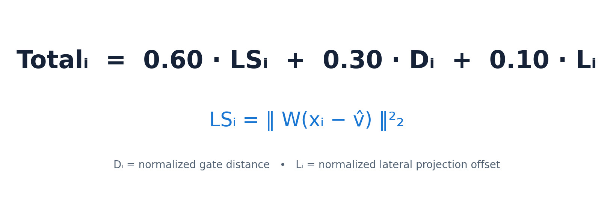
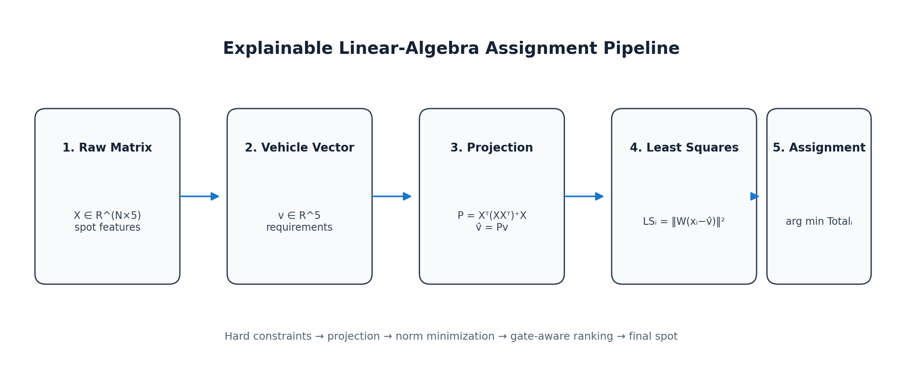
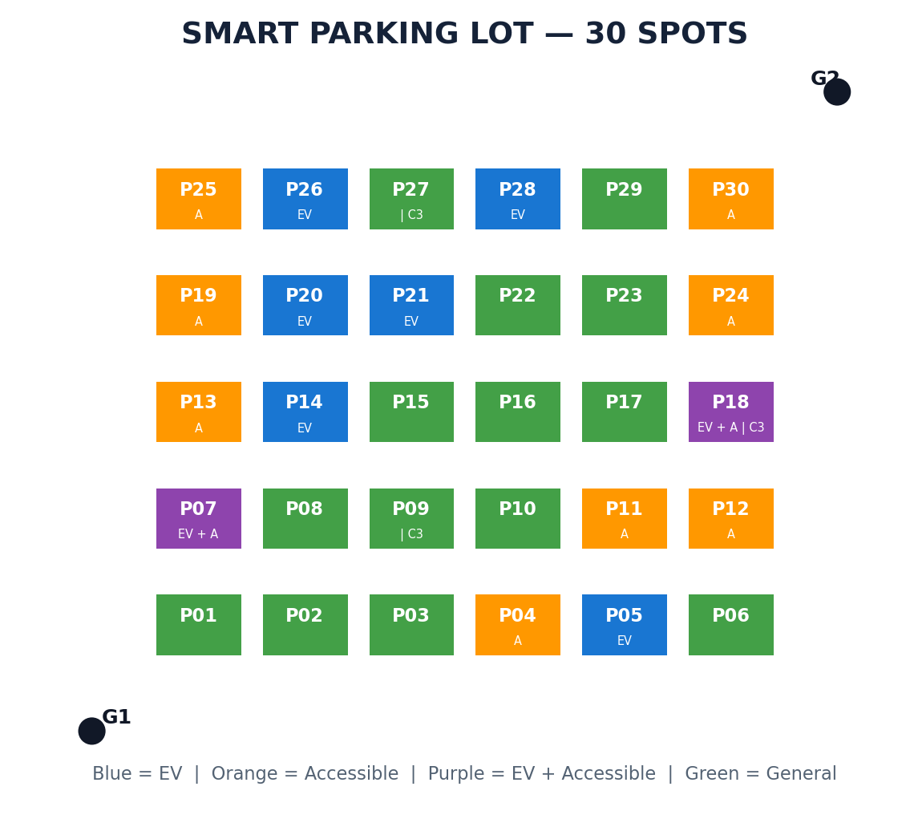

# Smart Parking Lot Optimization Using Linear Algebra

> **Course:** UE25MA242A – Mathematical Foundation for AI & Data Science (MFAD 2026)  
> **Institution:** Department of Artificial Intelligence & Data Science, PES University  
> **Project Level:** Experiential Learning – Level 2 Mini Project  

---

## 👥 Team Members

| Name | SRN | Role / Contributions |
| :--- | :--- | :--- |
| **Arya B** | `PES1UG25AM472` | Mathematical formulation, Orthogonal projection derivations |
| **Aryan R** | `PES1UG25AM473` | Linear algebra engine (`src/parking_engine.py`), Unit tests |
| **Hisham** | `PES1UG25AM488` | Desktop GUI visualizer (`src/app.py`), Simulation logs |
| **Chirag P** | `PES1UG25AM481` | Colab notebook (`SmartParking_MFAD_Colab_Demo.ipynb`), PPT deck |

---

## 📌 Table of Contents
1. [Project Overview](#-project-overview)
2. [Why Not Just "Nearest Free Spot"?](#-why-not-just-nearest-free-spot)
3. [Mathematical Pipeline & Architecture](#-mathematical-pipeline--architecture)
4. [Mathematical Formulation](#-mathematical-formulation)
   - [Feature Space & Vector Representation](#1-feature-space--vector-representation)
   - [Hard Feasibility Filtering](#2-hard-feasibility-filtering)
   - [Orthogonal Projection Operator](#3-orthogonal-projection-operator)
   - [Weighted Least-Squares Ranking](#4-weighted-least-squares-ranking)
   - [Approach Geometry & Lateral Offset](#5-approach-geometry--lateral-offset)
   - [Unified Cost Objective](#6-unified-cost-objective)
5. [Live Demonstration Scenario](#-live-demonstration-scenario)
6. [Repository Structure](#-repository-structure)
7. [Getting Started & Setup](#-getting-started--setup)
   - [Prerequisites](#prerequisites)
   - [Installation](#installation)
   - [Running the Desktop Application](#running-the-desktop-application)
   - [Running the Google Colab Notebook](#running-the-google-colab-notebook)
   - [Running Automated Unit Tests](#running-automated-unit-tests)
8. [Deliverables](#-deliverables)
9. [Viva & Review Q&A Guide](#-viva--review-qa-guide)

---

## 🚗 Project Overview

In dense urban environments, modern parking facilities cannot be treated as uniform grids where any empty bay suffices. Vehicles have specialized, non-negotiable requirements (e.g., Electric Vehicle charging ports, accessible bays for individuals with disabilities, and dimensional capacity for SUVs and vans) while drivers desire minimal travel distance from their entry gate.

This project implements an **explainable, mathematically rigorous smart parking assignment engine** grounded in **Linear Algebra**. Rather than treating parking allocation as a black-box heuristic or a data-heavy neural network, our system models parking bays and vehicle demands as vectors in a 5-dimensional feature space, projects demand onto the feasible feature subspace, and optimizes assignment via weighted least squares and geometric decomposition.



---

## ⚠️ Why Not Just "Nearest Free Spot"?

A naive greedy algorithm that selects the physically closest unoccupied bay frequently fails:
1. **Incompatible Facilities:** The closest empty bay may lack an EV charger needed by an electric car or lack wheelchair access required by a mobility-impaired driver.
2. **Vehicle Mismatch:** A compact parking bay cannot accommodate a large SUV.
3. **Suboptimal Approach Angles:** A spot might have a short direct line-of-sight Euclidean distance to the gate but require extreme lateral maneuvering or sharp turning against traffic flow.

Our system resolves this using a **two-phase architecture**:
- **Phase 1: Hard Feasibility Constraints** (filters out occupied, undersized, or incompatible bays).
- **Phase 2: Linear Algebra Optimization** (ranks valid bays via projection, least squares, and lateral geometry).

---

## 📐 Mathematical Pipeline & Architecture

The end-to-end allocation pipeline operates through the following stages:

```text
Incoming Vehicle Request
         ↓
Construct Demand Vector v ∈ ℝ⁵
         ↓
Hard Feasibility Filter (Vacant, EV Match, Accessible Match, Size Capacity)
         ↓
Construct Feasible Spot Matrix X ∈ ℝᵐˣ⁵
         ↓
Compute Orthogonal Projector: P = Xᵀ (X Xᵀ)⁺ X ∈ ℝ⁵ˣ⁵
         ↓
Project Vehicle Demand: v̂ = P v ∈ ℝ⁵
         ↓
Compute Weighted Least-Squares Residual: LSᵢ = || W (xᵢ - v̂) ||₂²
         ↓
Gate Decomposition: Euclidean Distance & Perpendicular Offset (I - P_g)
         ↓
Unified Objective Cost Minimization: C(i)
         ↓
Optimal Parking Spot Assigned & Grid Updated
```



---

## 🔬 Mathematical Formulation

### 1. Feature Space & Vector Representation
We define a 5-dimensional normalized feature space:
$$\mathbb{R}^5 = \text{span}\{\Delta x, \Delta y, \text{EV}, \text{Accessible}, \text{SizeCapacity}\}$$

Each spot $i$ is represented as a row vector $\mathbf{x}_i \in \mathbb{R}^5$:
$$\mathbf{x}_i = \left[ \frac{x_i - x_{\text{gate}}}{W_{\text{lot}}}, \frac{y_i - y_{\text{gate}}}{H_{\text{lot}}}, \mathbb{I}_{\text{EV}}(i), \mathbb{I}_{\text{Acc}}(i), \frac{\text{capacity}(i)}{3} \right]$$

For an incoming vehicle, the ideal spatial position is at the gate itself ($\Delta x = 0, \Delta y = 0$), giving the demand vector $\mathbf{v} \in \mathbb{R}^5$:
$$\mathbf{v} = \left[ 0, 0, \mathbb{I}_{\text{EV\_req}}, \mathbb{I}_{\text{Acc\_req}}, \frac{\text{size\_level}}{3} \right]^T$$
where $\text{size\_level} \in \{1: \text{Compact}, 2: \text{Standard}, 3: \text{Large}\}$.

### 2. Hard Feasibility Filtering
Spot $i$ is eligible if and only if:
$$\text{Eligible}(i) = (\neg \text{Occupied}_i) \land (\mathbf{v}_{\text{EV}} \implies \text{EV}_i) \land (\mathbf{v}_{\text{Acc}} \implies \text{Acc}_i) \land (\text{capacity}_i \ge \text{size}_{\text{veh}})$$
Let $m$ be the number of eligible spots. These form the feasible feature matrix $X \in \mathbb{R}^{m \times 5}$.

### 3. Orthogonal Projection Operator
The vehicle demand $\mathbf{v}$ may not lie entirely within the subspace spanned by available parking options. We project $\mathbf{v}$ onto the row-space of $X$ using the **Moore-Penrose pseudoinverse** $(XX^T)^+$:
$$\mathbf{P} = X^T (X X^T)^+ X \in \mathbb{R}^{5 \times 5}$$
$$\hat{\mathbf{v}} = \mathbf{P} \mathbf{v} \in \mathbb{R}^5$$

**Mathematical Guarantees:**
- **Idempotency:** $\mathbf{P}^2 = \mathbf{P}$ (projecting twice yields the same result: $\|\mathbf{P}^2 - \mathbf{P}\| < 10^{-14}$).
- **Symmetry:** $\mathbf{P}^T = \mathbf{P}$ (orthogonal projector: $\|\mathbf{P}^T - \mathbf{P}\| < 10^{-14}$).
- **Orthogonality of Residual:** $X(\mathbf{v} - \hat{\mathbf{v}}) = \mathbf{0}$.
- **Closest Subspace Point:** By the Projection Theorem, $\hat{\mathbf{v}}$ uniquely minimizes $\|\mathbf{v} - \mathbf{u}\|$ for all $\mathbf{u} \in \text{row}(X)$.

### 4. Weighted Least-Squares Ranking
The mismatch between spot $\mathbf{x}_i$ and the projected demand $\hat{\mathbf{v}}$ is quantified via a diagonal weighting matrix $W$:
$$W = \text{diag}([1.15, 1.15, 1.60, 1.60, 1.25])$$
$$\mathcal{L}_{\text{LS}}(i) = \| W (\mathbf{x}_i - \hat{\mathbf{v}}) \|_2^2 = \sum_{k=1}^5 w_k^2 (x_{ik} - \hat{v}_k)^2$$

### 5. Approach Geometry & Lateral Offset
Let $\mathbf{p}_i = [x_i - x_{\text{gate}}, y_i - y_{\text{gate}}]^T$ be the displacement vector from gate to spot. The lot-center unit direction is $\mathbf{g} = \mathbf{c} / \|\mathbf{c}\|_2$.
- **Parallel Projector:** $\mathbf{P}_g = \mathbf{g}\mathbf{g}^T$
- **Perpendicular Operator:** $\mathbf{I}_2 - \mathbf{P}_g$
- **Lateral Deviation:** $d_{\text{lat}}(i) = \| (\mathbf{I}_2 - \mathbf{P}_g) \mathbf{p}_i \|_2$
- **Euclidean Distance:** $d_{\text{gate}}(i) = \|\mathbf{p}_i\|_2$

### 6. Unified Cost Objective
Combining feature least-squares, gate proximity, and approach angle yields the total cost:
$$\mathcal{C}(i) = 0.60 \cdot \mathcal{L}_{\text{LS}}(i) + 0.30 \cdot \left(\frac{d_{\text{gate}}(i)}{\max_j d_{\text{gate}}(j)}\right) + 0.10 \cdot \left(\frac{d_{\text{lat}}(i)}{\max_j d_{\text{lat}}(j)}\right)$$

The optimal spot $i^*$ satisfies:
$$i^* = \arg\min_{i \in \text{Eligible}} \mathcal{C}(i)$$



---

## 🎯 Live Demonstration Scenario

**Scenario:** A large electric vehicle requiring an accessible bay enters via **Gate G2**.
- Vehicle Demand: $\mathbf{v} = [0, 0, 1.0, 1.0, 1.0]^T$.
- Out of 30 total spots, hard feasibility filters out 26 incompatible bays, leaving **4 feasible candidates**: `P07`, `P18`, `P25`, and `P30`.

| Rank | Spot ID | Least-Squares Residual $\mathcal{L}_{\text{LS}}$ | Gate Distance $d_{\text{gate}}$ (m) | Lateral Offset $d_{\text{lat}}$ (m) | Total Cost $\mathcal{C}$ | Decision |
| :---: | :---: | :---: | :---: | :---: | :---: | :---: |
| **🥇 1** | **P30** | **0.0637** | **3.11 m** | **0.24 m** | **0.1005** | **ASSIGNED** |
| 🥈 2 | P18 | 0.3576 | 6.96 m | 3.58 m | 0.3979 | Feasible |
| 🥉 3 | P25 | 1.0084 | 13.38 m | 6.92 m | 0.9581 | Feasible |
| 4 | P07 | 1.5594 | 15.86 m | 1.91 m | 1.2632 | Feasible |

**Result:** `P30` is assigned as it minimizes the unified linear-algebra cost objective.

---

## 📁 Repository Structure

```text
.
├── README.md                          # Comprehensive project documentation
├── requirements.txt                   # Python dependencies (numpy, pandas, matplotlib)
├── .gitignore                         # Git exclusion rules
├── presentation.pptx                  # 14-slide final presentation deck
├── SmartParking_MFAD_Colab_Demo.ipynb # Interactive Google Colab notebook
├── assets/                            # Architecture and layout diagrams
│   ├── objective.png
│   ├── parking_lot.png
│   └── pipeline.png
├── data/                              # Data files for simulation
│   ├── parking_layout.csv
│   └── sample_vehicles.csv
├── src/                               # Application source code
│   ├── __init__.py
│   ├── parking_engine.py              # Linear algebra & projection engine
│   └── app.py                         # Tkinter interactive desktop visualizer
└── tests/                             # Automated test suite
    ├── __init__.py
    └── test_engine.py                 # Unit tests verifying mathematical properties
```

---

## 🚀 Getting Started & Setup

### Prerequisites
- Python 3.10 or higher
- Git

### Installation
1. Clone the repository:
   ```bash
   git clone https://github.com/<your-username>/<repo-name>.git
   cd <repo-name>
   ```

2. (Optional) Create and activate a virtual environment:
   ```bash
   # Windows
   python -m venv venv
   .\venv\Scripts\activate

   # Linux / macOS
   python3 -m venv venv
   source venv/bin/activate
   ```

3. Install required dependencies:
   ```bash
   pip install -r requirements.txt
   ```

### Running the Desktop Application
Launch the interactive graphical interface:
```bash
python src/app.py
```
- Features: Live 30-spot parking grid, interactive vehicle entry form, step-by-step mathematical logs, JSON export of results.

### Running the Google Colab Notebook
Open [`SmartParking_MFAD_Colab_Demo.ipynb`](SmartParking_MFAD_Colab_Demo.ipynb) in Google Colab or your local Jupyter environment.  
- The notebook runs smoothly whether cloned or run in the cloud, guiding the audience through each mathematical stage with interactive plots and matrix outputs.

### Running Automated Unit Tests
Verify mathematical invariants and assignment reproducibility:
```bash
python -m unittest discover -s tests -v
```
All 6 tests verify:
- ✅ Idempotency & symmetry of the projection operator ($\mathbf{P}^2 = \mathbf{P}, \mathbf{P}^T = \mathbf{P}$)
- ✅ EV vehicle charger matching
- ✅ Accessible bay assignment for large vehicles
- ✅ Multi-candidate competition in the main demo scenario
- ✅ Non-reuse of occupied bays
- ✅ Deterministic numerical reproducibility

---

## 📦 Deliverables

1. **GitHub Repository:** Complete source code, tests, documentation, and configuration.
2. **Presentation Deck (`presentation.pptx`):** 14 slides detailing problem statement, linear algebra theory, derivations, worked example, and results.
3. **Interactive Simulation (`src/app.py`):** Standalone desktop GUI.
4. **Interactive Notebook (`SmartParking_MFAD_Colab_Demo.ipynb`):** Step-by-step mathematical demonstration with viva cheat sheet.

---

## 🧠 Viva & Review Q&A Guide

Prepare for review questions with these concise, mathematically precise answers:

### Q1: Why do you need Orthogonal Projection if you filter first?
> **Answer:** Filtering guarantees feasibility (binary/categorical constraints), but among eligible bays, features vary continuously (different distances, normalized sizes, chargers). The vehicle demand vector $\mathbf{v}$ may not lie in the subspace generated by the available spots. Orthogonal projection finds $\hat{\mathbf{v}} = \mathbf{P}\mathbf{v}$, which is the closest realizable demand vector in the feasible feature subspace.

### Q2: Why use the Moore-Penrose pseudoinverse $(XX^T)^+$ instead of a standard inverse?
> **Answer:** The Gram matrix $XX^T$ is an $m \times m$ matrix where $m$ is the number of eligible spots. When $m > 5$ (more spots than features) or when candidate spots have linearly dependent features, $XX^T$ is rank-deficient and not invertible. The Moore-Penrose pseudoinverse guarantees numerical stability and always produces a valid, unique orthogonal projector.

### Q3: What mathematical properties verify that $P$ is an orthogonal projector?
> **Answer:** An operator $\mathbf{P}$ is an orthogonal projector if and only if it is:
> 1. **Idempotent:** $\mathbf{P}^2 = \mathbf{P}$ (projecting an already projected vector leaves it unchanged).
> 2. **Symmetric (Self-Adjoint):** $\mathbf{P}^T = \mathbf{P}$ (ensuring the residual $\mathbf{v} - \hat{\mathbf{v}}$ is orthogonal to the subspace).  
> In our unit tests and notebook, $\|\mathbf{P}^2 - \mathbf{P}\|_2 < 10^{-14}$ and $\|\mathbf{P}^T - \mathbf{P}\|_2 < 10^{-14}$.

### Q4: How is lateral offset calculated using linear algebra?
> **Answer:** We define the approach direction unit vector $\mathbf{g}$. The projection matrix onto this direction is $\mathbf{P}_g = \mathbf{g}\mathbf{g}^T$. The orthogonal complement projector is $\mathbf{I}_2 - \mathbf{P}_g$. Applying this operator to the position vector $\mathbf{p}_i$ gives the perpendicular lateral deviation vector: $\mathbf{p}_{\perp} = (\mathbf{I}_2 - \mathbf{P}_g)\mathbf{p}_i$. Its magnitude $\|\mathbf{p}_{\perp}\|_2$ quantifies lateral maneuver difficulty.

### Q5: Why is this not a Machine Learning model?
> **Answer:** In machine learning, weights are learned from historical data via gradient descent. Here, all mathematical steps are **exact analytical linear algebra operations** (subspace projection, pseudoinverse, matrix transformations, and weighted residual minimization). This provides 100% determinism and full mathematical explainability for MFAD evaluation.

---

## 📜 License
This project is submitted for academic evaluation under the course **UE25MA242A – Mathematical Foundation for AI & Data Science (MFAD 2026)** at PES University.
